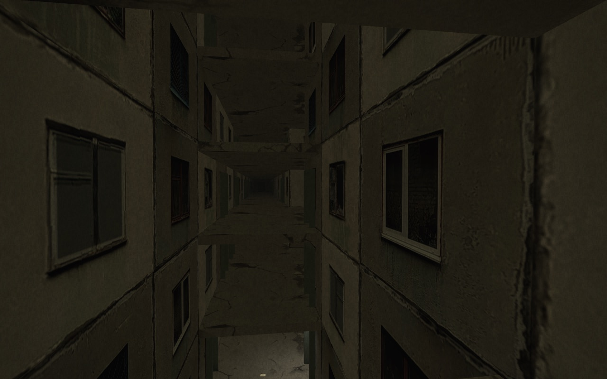
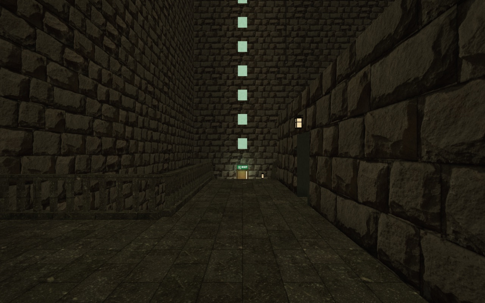
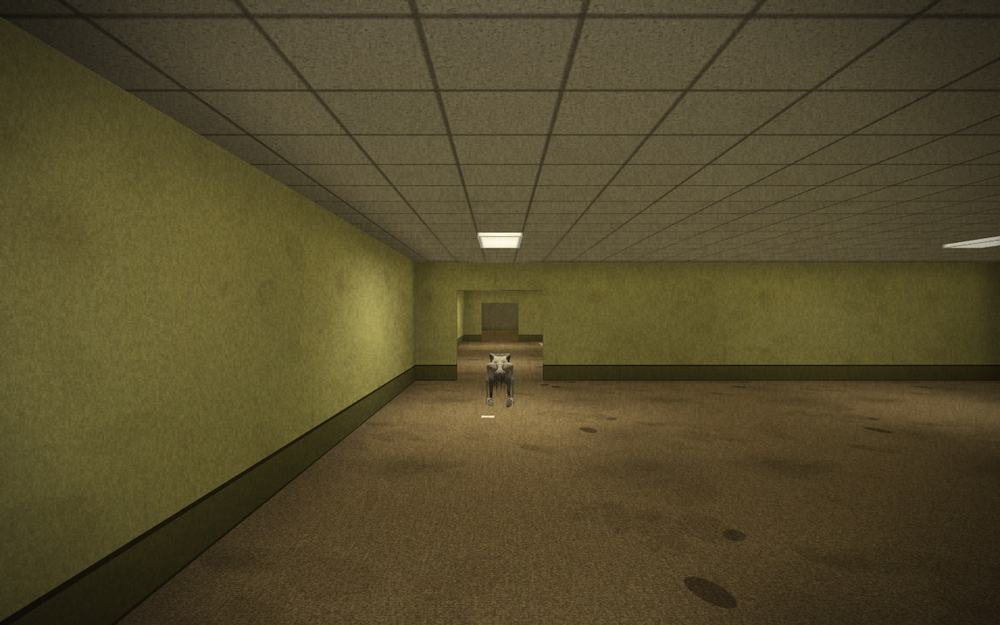
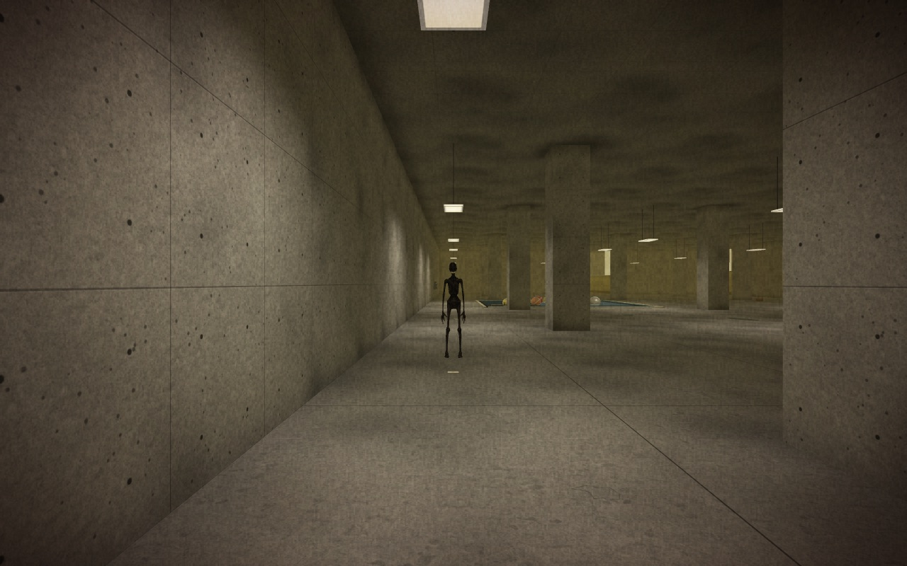
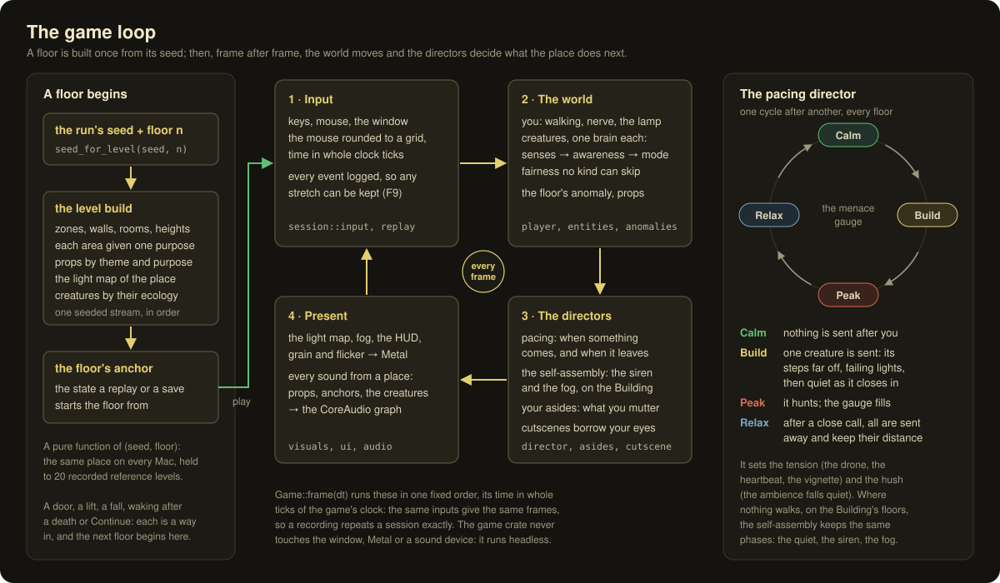
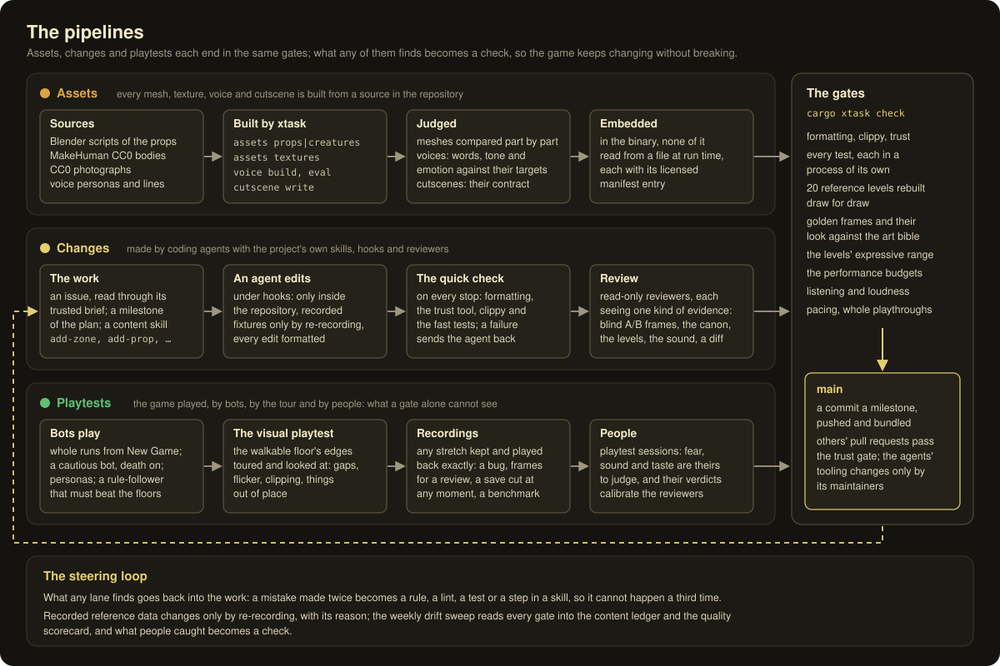

# The liminal game

An evolving liminal-horror game for macOS on Apple Silicon, inspired by the
Backrooms, the SCP Foundation and creepypasta, together with the full set of
skills, tools and pipelines its coding agents use to build it. Play it to get
lost in a place that is never quite the same; read it for game development
practice, both as software (a game that repeats exactly, is tested and
playtested on every change, and grows without breaking) and as design (the
research every creature, place and sound rests on).

## The game

You came after her: to the walkway of a tunnel in Seoul that she measured
every night until she did not come back, and that did not end for you
either, until a door was in its wall.
First comes the Building: vast concrete floors at many heights over a void
with no top and no bottom, where nothing walks, a siren sounds far off, and a
fog comes up out of the dark. Inside its walls are the Backrooms: damp,
fluorescent rooms that are almost, but not quite, a real place, and go on for
ever. There is no way back; every exit leads down. Someone came this way
before you, and left a trail of folded paper, a camp on every floor and a
page of her notebook at each. Follow her down.

- **Find the way down.** No map and no arrow: a door is found by its light
  and the sound it makes, and every floor is built anew for each run.
- **Keep your nerve and your light.** The dark and what walks in it wear
  your sanity down; the lamp's batteries and almond water are found on the
  way, and never enough.
- **What walks the halls keeps rules.** Each creature hunts by one sense and
  is beaten by one counter; it warns before it strikes, and it learns your
  habits over a run.
- **The place breathes.** A director paces every floor: quiet, then
  something coming, then the hunt, then relief. Sounds come from where
  things are, and light from the place itself.
- **Keep what happened.** F9 records any stretch of play, to watch again
  from the title or to play on from any moment of it.

<table>
  <tr>
    <td></td>
    <td></td>
  </tr>
  <tr>
    <td></td>
    <td></td>
  </tr>
</table>

*Above, two of the Building's floors: the Well and the Stair Halls. Below,
the rooms inside its walls, and what walks them, seen from afar.*

To play, on an Apple Silicon Mac with Rust installed: `cargo run --release`.
The requirements, the app bundle and every command-line option are in
[`docs/engineering/BUILD.md`](docs/engineering/BUILD.md); the keys and the
settings in [`docs/design/UI.md`](docs/design/UI.md).

## The harness

The game is written by coding agents (Claude Code), and the harness they work
in is part of the project and grows with it: a skill for each kind of content,
hooks and rules that hold the game's invariants, read-only reviewers that each
judge one kind of evidence, and gates that every change passes
([`docs/engineering/AGENTS.md`](docs/engineering/AGENTS.md)). `CLAUDE.md` is
the map an agent reads first.

**The game loop.** A floor is a pure function of the run's seed and its
number; every frame then moves the world in one fixed order, on the game's
own clock, so a session can be recorded and replayed exactly. Above the
creatures, the directors decide what the place does next
([`docs/engineering/ARCHITECTURE.md`](docs/engineering/ARCHITECTURE.md)).

**The pipelines.** Assets are built from sources in the repository, changes
are made under hooks and checked on every stop, and playtests by bots, by a
visual tour, by recordings and by people find what the gates cannot. What any
of them finds becomes a check
([`docs/engineering/DEVELOPMENT.md`](docs/engineering/DEVELOPMENT.md),
[`docs/engineering/VISUAL_PLAYTEST.md`](docs/engineering/VISUAL_PLAYTEST.md),
[`docs/engineering/TRUST.md`](docs/engineering/TRUST.md)).

## Research and materials

Every decision in the design quotes the research it rests on, and every
source is linked ([`docs/research/SOURCES.md`](docs/research/SOURCES.md), the
notes in [`docs/research/`](docs/research/README.md)). The core themes:

**Good game design**

- **Fear and pacing.** AI directors and the cycle of build-up, peak and
  relief; creature AI that is frightening and fair (tells before a strike,
  a counter for every threat): [`creature-ai-and-fear.md`](docs/research/creature-ai-and-fear.md),
  [`docs/design/ENTITIES.md`](docs/design/ENTITIES.md).
- **Rule-monsters and folklore.** Why the SCP Foundation's rules frighten,
  the Backrooms' entities and the Samosbor, creepypasta and folklore, and how
  a thing is pictured so it frightens: [`scp.md`](docs/research/scp.md),
  [`backrooms-and-samosbor.md`](docs/research/backrooms-and-samosbor.md),
  [`folklore-and-imaging.md`](docs/research/folklore-and-imaging.md).
- **Liminal places.** Emptiness, monotony, the familiar made wrong; levels
  generated with a purpose for every area, route marks and things put away:
  [`docs/design/PILLARS.md`](docs/design/PILLARS.md),
  [`wayfinding-and-secrets.md`](docs/research/wayfinding-and-secrets.md).
- **Real things, slightly wrong.** Props, vending machines and windows made
  from real ones, then made uncanny: [`props-census.md`](docs/research/props-census.md),
  [`vending-machines.md`](docs/research/vending-machines.md),
  [`window-horror.md`](docs/research/window-horror.md).
- **A voice under the breath.** Barks chosen like Valve's dynamic dialog,
  never said twice: [`inner-voice.md`](docs/research/inner-voice.md).

**Good software creation**

- **The same game twice.** Deterministic levels and frames, correctly
  rounded math, replays and saves as one format: [`replays.md`](docs/research/replays.md),
  [`docs/engineering/REPLAYS.md`](docs/engineering/REPLAYS.md).
- **Testing what cannot be asserted.** Golden frames, blind A/B reviews,
  reviewers calibrated on known answers, a visual tour of every edge, and
  people's playtests: [`visual-qa.md`](docs/research/visual-qa.md),
  [`docs/research/PLAYTEST.md`](docs/research/PLAYTEST.md).
- **Agents that can be trusted.** Whose words an agent acts on in a public
  repository, and the gates that hold it: [`agent-trust.md`](docs/research/agent-trust.md),
  [`docs/engineering/TRUST.md`](docs/engineering/TRUST.md).
- **Performance with a budget.** Every speed-up measured against a recorded
  history: [`docs/engineering/PERF.md`](docs/engineering/PERF.md).

The docs are sorted by kind (the game, the research, the plan, the code):
[`docs/README.md`](docs/README.md).

The project is under the [Liminal license 1.0](LICENSE): the MIT license's
clauses, unchanged, and one clause more; the parts drawn from SCP and
Backrooms wiki articles are CC BY-SA 3.0, with their attribution.
